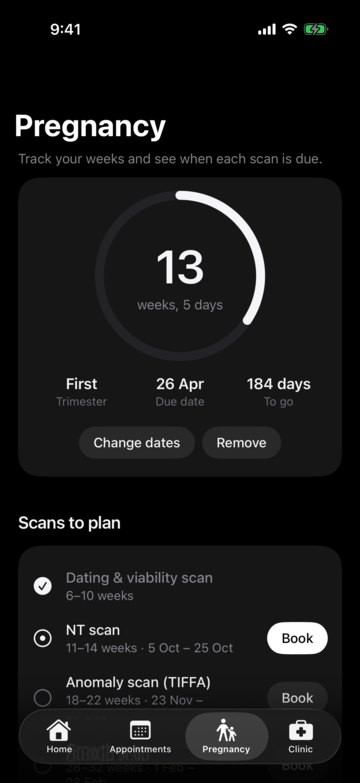
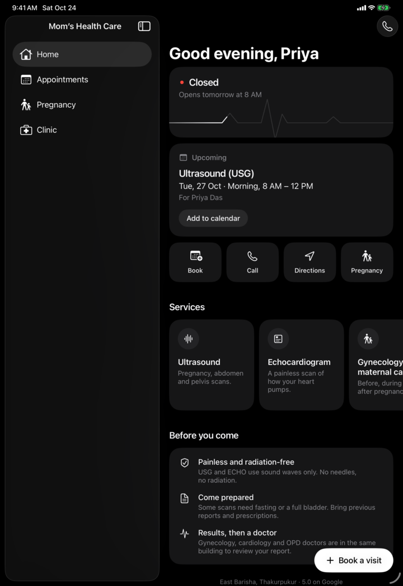

# Mom’s Health Care — iPhone, iPad and Mac app

Free, open-source app for [Mom’s Health Care](https://momshealthcare.site.je/), a diagnostic centre
and clinic in Thakurpukur, Kolkata. Same content and black-and-white design as the website, with
appointment booking that reaches the clinic inbox (**drpubalisarkar@gmail.com**).

Written in SwiftUI for iPhone and iPad (iOS 16 and later). The same app runs on Apple silicon Macs
and Apple Vision Pro as an iPad app. On iPad and Mac it uses a sidebar instead of tabs.

The Android version lives at [momshealthcare-android](https://github.com/MinecraftUser21/momshealthcare-android).

## What’s in the app

- **Book a visit**: pick a service, a day and a time; the clinic calls back to confirm.
  Saved patients fill the form in one tap.
- **Appointments**: every request you’ve sent; add one to your calendar, cancel it, or book again.
- **Pregnancy**: enter your last period (or due date) to see your week, due date and when each
  scan is usually done, with a Book button for each.
- **Services**: what each one is and how to prepare.
- **Clinic**: live open/closed status, opening hours, directions, one-tap call, and a 112 emergency button.
- **Appearance**: Dark, Light or Match phone.

Everything stays on the device. Only a booking or cancellation is sent, and only to the clinic.
Animations pause with Reduce Motion or Low Power Mode.

## Run it

Apple only allows apps to be installed from the App Store, TestFlight or Xcode, so there is no file
to download here.

1. On a Mac with Xcode 16 or later, open `MomsHealthCare.xcodeproj`.
2. Choose your iPhone or iPad (or “My Mac (Designed for iPad)”) and press **Run**.
   A free Apple ID works for your own devices; apps installed this way need re-installing every 7 days.

To publish it on the App Store (free for patients), the clinic needs an Apple Developer account,
then **Product › Archive** in Xcode and upload. Set your team under **Signing & Capabilities** first.

## How booking reaches the doctor

The app posts to the website’s own FormSubmit form (`formsubmit.co/ajax/drpubalisarkar@gmail.com`),
which is already activated for that inbox. It uses the website’s field names (Patient Name, Phone,
Service, Preferred Date, Preferred Time, Notes) plus “Booked via: iOS app”, so every email looks the
same. If sending fails, the app offers **Try again**, **Use email app** (pre-filled to the doctor)
or **Call**.

## Code

| File | What it does |
| --- | --- |
| `MomsHealthCareApp.swift` | App entry; tabs on iPhone, sidebar on iPad and Mac |
| `HomeView.swift` | Status, next appointment, quick actions, services |
| `AppointmentsView.swift` | History, add to calendar, cancel |
| `PregnancyView.swift` | Week tracker and scan timeline |
| `ClinicView.swift` | Hours, services, emergency, settings |
| `BookingView.swift` | Booking form, same rules as the website |
| `ServiceSheet.swift` | Service details and how to prepare |
| `Sender.swift` | Sends requests to the clinic inbox |
| `Clinic.swift`, `Store.swift` | Clinic data, Kolkata time, saved data |
| `Theme.swift`, `Components.swift` | Colours, buttons, heartbeat line, shared pieces |

Every push to `main` is built by GitHub Actions on a Mac, run on iPhone and iPad simulators, and
screenshots are saved as build artifacts. Debug builds accept `-demo YES`, `-tab <home|appointments|pregnancy|clinic>`
and `-book YES` launch arguments for those screenshots.

## License

The code is released under the [MIT License](LICENSE). Icons are Apple’s SF Symbols, used as
provided by iOS. The clinic’s name, logo and written content belong to Mom’s Health Care; if you
reuse this app for another clinic, replace them.
